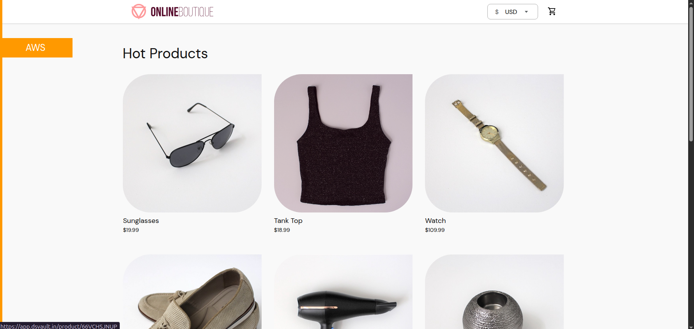
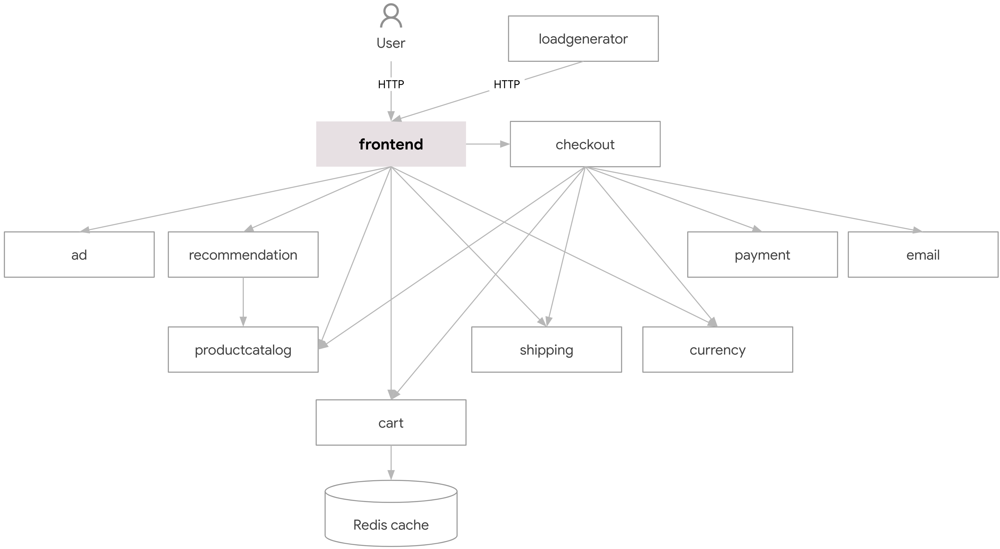
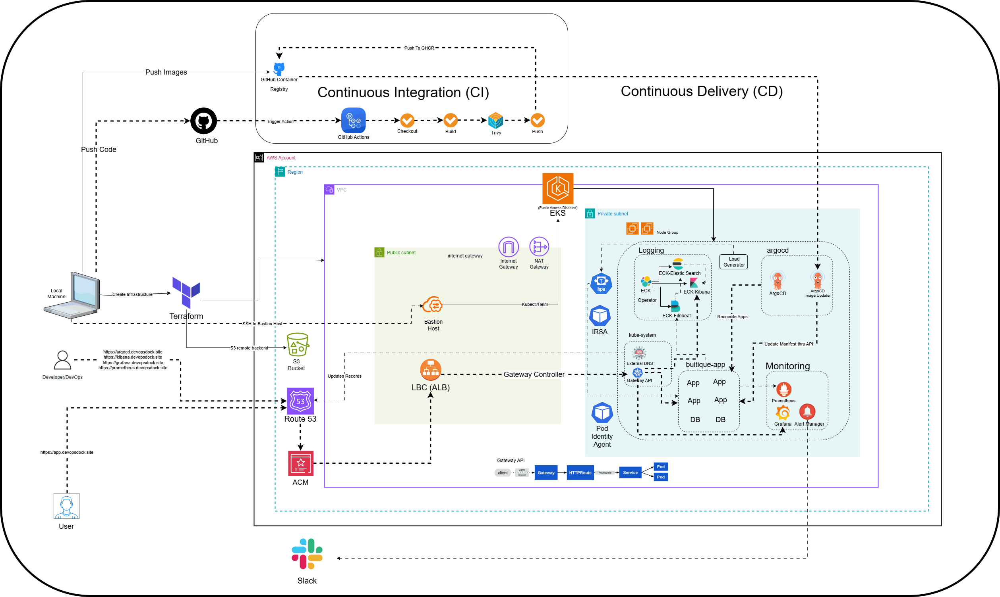
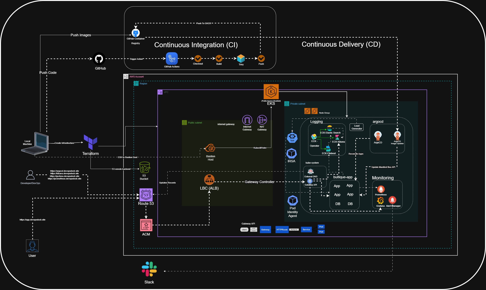
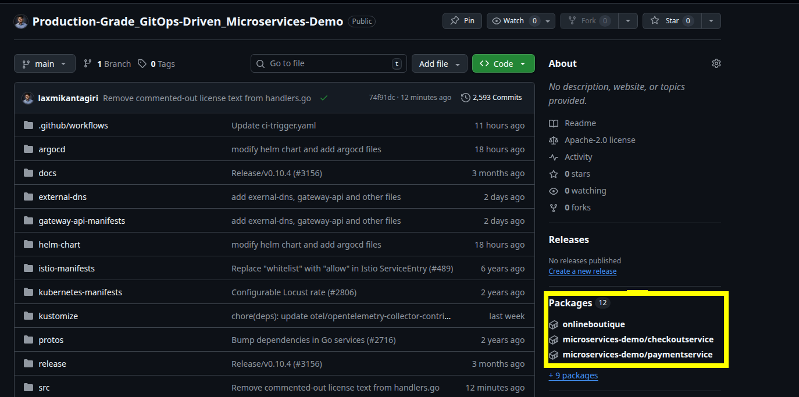
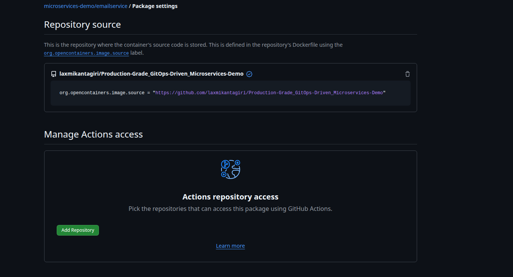

# Production-Grade GitOps-Driven Microservices

A hands-on, end-to-end GitOps project that deploys the **Online Boutique** microservices demo on **AWS EKS**, using Terraform for infrastructure, GitHub Actions for CI, Argo CD for CD, Argo CD Image Updater for automated image rollouts, and a full observability stack (Prometheus, Grafana, Alertmanager, Elasticsearch, Filebeat, Kibana) with autoscaling (HPA).

Repository: [keshavp07-git/Production-Grade-GitOps-Driven-Microservices](https://github.com/keshavp07-git/Production-Grade-GitOps-Driven-Microservices)

---

## Table of Contents

1. [About the Application](#about-the-application)
2. [Architecture](#architecture)
3. [Implementation](#implementation)
   - [Provision infrastructure with Terraform](#1-provision-infrastructure-with-terraform)
   - [Bastion host configuration](#2-bastion-host-configuration)
   - [AWS Load Balancer Controller](#3-aws-load-balancer-controller)
   - [Gateway API](#4-gateway-api)
   - [External DNS](#5-external-dns)
   - [Argo CD](#6-argo-cd)
   - [CI with GitHub Actions](#7-ci-with-github-actions)
   - [CD with Argo CD](#8-cd-with-argo-cd)
   - [Argo CD Image Updater (CI + CD integration)](#9-argo-cd-image-updater-ci--cd-integration)
4. [Observability](#observability)
5. [Scaling & Reliability](#scaling--reliability)
6. [Cleanup](#cleanup)
7. [FAQs](#faqs)

---

## About the Application

Online Boutique is a cloud-native e-commerce demo built as a **microservices architecture**: 11 independent services, written in different languages, communicating over **gRPC**. Each service handles one business function, runs independently and can be scaled and deployed on its own.

| **Service** | **Language** | **Description** |
| --- | --- | --- |
| frontend | Go | Exposes an HTTP server to serve the website. Does not require signup/login and generates session IDs for all users automatically. |
| cartservice | C# | Stores the items in the user's shopping cart in Redis and retrieves it. |
| productcatalogservice | Go | Provides the list of products from a JSON file and ability to search products and get individual products. |
| currencyservice | Node.js | Converts one money amount to another currency. Uses real values fetched from the European Central Bank. It's the highest QPS service. |
| paymentservice | Node.js | Charges the given credit card info (mock) with the given amount and returns a transaction ID. |
| shippingservice | Go | Gives shipping cost estimates based on the shopping cart. Ships items to the given address (mock). |
| emailservice | Python | Sends users an order confirmation email (mock). |
| checkoutservice | Go | Retrieves user cart, prepares order and orchestrates the payment, shipping and the email notification. |
| recommendationservice | Python | Recommends other products based on what's given in the cart. |
| adservice | Java | Provides text ads based on given context words. |
| loadgenerator | Python/Locust | Continuously sends requests imitating realistic user shopping flows to the frontend. |

Screenshot of the application:



### Data & persistence

Most services are **stateless**; only the cart uses persistence (Redis). This is intentional, to keep the demo lightweight and focus on platform concerns like CI/CD, observability, scaling and networking.

| Service | Persistent Storage | Type |
| --- | --- | --- |
| cartservice | ✅ Yes | Redis |
| checkoutservice | ❌ No | Stateless (orders are not persisted) |
| productcatalogservice | ❌ No | In-memory JSON |
| recommendationservice | ❌ No | Stateless |
| paymentservice | ❌ No | Mock |
| shippingservice | ❌ No | Mock |
| emailservice | ❌ No | Mock |
| adservice | ❌ No | In-memory |
| frontend | ❌ No | Stateless |
| currencyservice | ❌ No | In-memory |
| loadgenerator | ❌ No | Stateless |

---

## Architecture



### Project (GitOps) Architecture





---

## Implementation

### Prerequisites

Install on your local machine:

- AWS CLI
- Terraform
- An IAM user with an access key and secret access key, configured with `aws configure`

### 1. Provision infrastructure with Terraform

Clone the repo and move to the `terraform` directory:

```bash
git clone https://github.com/keshavp07-git/Production-Grade-GitOps-Driven-Microservices.git
cd Production-Grade-GitOps-Driven-Microservices/terraform/
```

Initialize, review the plan, and apply:

```bash
terraform init
terraform plan
terraform apply
```

After apply you will see the bastion host's public IP as an output. The instance's private key is also created in the current directory.

#### (Optional) Terraform remote backend on S3

Create a bucket (replace the name with a globally unique one):

```bash
aws s3api create-bucket \
  --bucket <your-terraform-backend-bucket> \
  --region us-east-1
```

Enable versioning and encryption:

```bash
# Enable versioning
aws s3api put-bucket-versioning \
  --bucket <your-terraform-backend-bucket> \
  --versioning-configuration Status=Enabled

# Enable encryption
aws s3api put-bucket-encryption \
  --bucket <your-terraform-backend-bucket> \
  --server-side-encryption-configuration '{
    "Rules":[{
      "ApplyServerSideEncryptionByDefault":{
        "SSEAlgorithm":"AES256"
      }
    }]
  }'
```

Add this backend block in `terraform.tf`:

```hcl
terraform {
  backend "s3" {
    bucket = "<your-terraform-backend-bucket>"
    key    = "s3-backend"
    region = "us-east-1"
  }
}
```

Run `terraform init` again. Since a local state file already exists, Terraform will ask whether to copy it to the new backend:

```bash
Initializing the backend...
Do you want to copy existing state to the new backend?
  ...
  Enter a value:
```

Type `yes`; the state moves to S3 and is read from there from now on.

### 2. Bastion host configuration

SSH to the bastion host from the same terraform directory (where the private key was created):

```bash
ssh -i bastion-key.pem ubuntu@<publicIP>
```

Install the following tools on the bastion host:

- [AWS CLI](https://docs.aws.amazon.com/cli/latest/userguide/getting-started-install.html)
- [kubectl](https://kubernetes.io/docs/tasks/tools/install-kubectl-linux/#install-using-native-package-management)
- [Helm](https://helm.sh/docs/intro/install/)
- [eksctl](https://docs.aws.amazon.com/eks/latest/eksctl/installation.html)

Run `aws configure` with the same access keys used locally, then import the kubeconfig:

```bash
aws eks update-kubeconfig --region <your-region> --name <your-cluster-name>
```

Verify:

```bash
kubectl get nodes
```

Expected output:

```bash
NAME                         STATUS   ROLES    AGE    VERSION
ip-10-0-1-248.ec2.internal   Ready    <none>   100m   v1.33.5-eks-ecaa3a6
ip-10-0-2-138.ec2.internal   Ready    <none>   100m   v1.33.5-eks-ecaa3a6
```

### 3. AWS Load Balancer Controller

Docs: [Helm install guide](https://docs.aws.amazon.com/eks/latest/userguide/lbc-helm.html) · [Controller installation](https://kubernetes-sigs.github.io/aws-load-balancer-controller/latest/deploy/installation/)

**IAM OIDC provider** (already created at the Terraform level in this project; skip if you have one):

```bash
eksctl utils associate-iam-oidc-provider \
    --region <region-code> \
    --cluster <your-cluster-name> \
    --approve
```

**Create the IAM policy and service account:**

1. Download the IAM policy for the controller:

    ```bash
    curl -O https://raw.githubusercontent.com/kubernetes-sigs/aws-load-balancer-controller/v2.14.1/docs/install/iam_policy.json
    ```

2. Create the IAM policy:

    ```bash
    aws iam create-policy \
        --policy-name AWSLoadBalancerControllerIAMPolicy \
        --policy-document file://iam_policy.json
    ```

3. Create the service account (replace cluster name, region and account ID):

    ```bash
    eksctl create iamserviceaccount \
        --cluster=<cluster-name> \
        --namespace=kube-system \
        --name=aws-load-balancer-controller \
        --attach-policy-arn=arn:aws:iam::<AWS_ACCOUNT_ID>:policy/AWSLoadBalancerControllerIAMPolicy \
        --override-existing-serviceaccounts \
        --region <aws-region-code> \
        --approve
    ```

**Install the controller:**

```bash
helm repo add eks https://aws.github.io/eks-charts
helm repo update eks

helm upgrade -i aws-load-balancer-controller eks/aws-load-balancer-controller \
  -n kube-system \
  --set clusterName=<your-cluster-name> \
  --set region=us-east-1 \
  --set vpcId=<your-vpc-id> \
  --set serviceAccount.create=false \
  --set serviceAccount.name=aws-load-balancer-controller \
  --set controllerConfig.featureGates.NLBGatewayAPI=true \
  --set controllerConfig.featureGates.ALBGatewayAPI=true \
  --version 3.0.0
```

Verify:

```bash
kubectl get deployment -n kube-system aws-load-balancer-controller

NAME                           READY   UP-TO-DATE   AVAILABLE   AGE
aws-load-balancer-controller   2/2     2            2           84s
```

### 4. Gateway API

Docs: [AWS LBC – L7 Gateway](https://kubernetes-sigs.github.io/aws-load-balancer-controller/latest/guide/gateway/l7gateway/)

Install the CRDs:

```bash
# Standard Gateway API CRDs [REQUIRED]
kubectl apply -f https://github.com/kubernetes-sigs/gateway-api/releases/download/v1.3.0/standard-install.yaml

# Experimental Gateway API CRDs [OPTIONAL: used for L4 routes]
kubectl apply -f https://github.com/kubernetes-sigs/gateway-api/releases/download/v1.3.0/experimental-install.yaml

# AWS LBC Gateway API specific CRDs
kubectl apply -f https://raw.githubusercontent.com/kubernetes-sigs/aws-load-balancer-controller/refs/heads/main/config/crd/gateway/gateway-crds.yaml
```

> **Note:** All the configs are already available in their respective directories in this repo. Use them directly or copy from this guide.

**GatewayClass** – `gateway-class.yaml`

```yaml
apiVersion: gateway.networking.k8s.io/v1beta1
kind: GatewayClass
metadata:
  name: aws-alb-gateway-class
spec:
  controllerName: gateway.k8s.aws/alb
```

```bash
kubectl apply -f gateway-class.yaml
```

**LoadBalancerConfiguration** – `alb-config.yaml` (specific to the AWS LBC; other Gateway API controllers don't need it)

```yaml
apiVersion: gateway.k8s.aws/v1beta1
kind: LoadBalancerConfiguration
metadata:
  name: app-gw-lbconfig
  namespace: default
spec:
  scheme: internet-facing
  listenerConfigurations:
    - protocolPort: HTTPS:443
      defaultCertificate: <certificate arn>
```

```bash
kubectl apply -f alb-config.yaml
```

**Gateway** – `gateway.yaml`

```yaml
apiVersion: gateway.networking.k8s.io/v1beta1
kind: Gateway
metadata:
  name: app-alb-gateway
  namespace: default
spec:
  gatewayClassName: aws-alb-gateway-class
  infrastructure:
    parametersRef:
      kind: LoadBalancerConfiguration
      name: app-gw-lbconfig
      group: gateway.k8s.aws
  listeners:
  - name: http
    protocol: HTTP
    port: 80
    hostname: "*.<your-domain>"
    allowedRoutes:
      namespaces:
        from: All
  - name: https
    protocol: HTTPS
    hostname: "*.<your-domain>"
    port: 443
    allowedRoutes:
      namespaces:
        from: All
```

```bash
kubectl apply -f gateway.yaml
```

Verify the gateway and the load balancer in the AWS console:

```bash
kubectl get gateway

NAME              CLASS                   ADDRESS                                                                  PROGRAMMED   AGE
app-alb-gateway   aws-alb-gateway-class   k8s-default-appalbga-xxxxxxxxxx-xxxxxxxxxx.us-east-1.elb.amazonaws.com   Unknown      5s
```

### 5. External DNS

Docs: [ExternalDNS on AWS (Pod Identity / OIDC)](https://github.com/kubernetes-sigs/external-dns/blob/master/docs/tutorials/aws.md#using-helm-with-oidc) · [ExternalDNS with Gateway API](https://kubernetes-sigs.github.io/external-dns/v0.13.1/tutorials/gateway-api/#manifest-with-rbac)

Create `policy.json`:

```json
{
  "Version": "2012-10-17",
  "Statement": [
    {
      "Effect": "Allow",
      "Action": [
        "route53:ChangeResourceRecordSets",
        "route53:ListResourceRecordSets",
        "route53:ListTagsForResources"
      ],
      "Resource": [
        "arn:aws:route53:::hostedzone/*"
      ]
    },
    {
      "Effect": "Allow",
      "Action": [
        "route53:ListHostedZones"
      ],
      "Resource": [
        "*"
      ]
    }
  ]
}
```

Create the policy:

```bash
aws iam create-policy --policy-name "AllowExternalDNSUpdates" --policy-document file://policy.json

export POLICY_ARN=$(aws iam list-policies \
 --query 'Policies[?PolicyName==`AllowExternalDNSUpdates`].Arn' --output text)

export EKS_CLUSTER_NAME=<your-cluster-name>
```

**Using EKS Pod Identity.** The `eks-pod-identity-agent` add-on is created while provisioning the cluster (via Terraform), so this step can be skipped. To create it manually:

```bash
eksctl create addon --cluster $EKS_CLUSTER_NAME --name eks-pod-identity-agent
```

Create the namespace and the pod identity association:

```bash
kubectl create ns external-dns

eksctl create podidentityassociation \
  --cluster $EKS_CLUSTER_NAME \
  --namespace external-dns \
  --service-account-name external-dns \
  --role-name external-dns-pod-identity-role \
  --permission-policy-arns $POLICY_ARN
```

Unlike IRSA, Pod Identity needs no service account annotations; the agent injects credentials at runtime.

Deploy ExternalDNS:

```bash
helm repo add external-dns https://kubernetes-sigs.github.io/external-dns/
helm install external-dns external-dns/external-dns -n external-dns --version 1.20.0
kubectl get pod -n external-dns

NAME                            READY   STATUS    RESTARTS   AGE
external-dns-6f95d4687d-6tc2g   1/1     Running   0          94s
```

Get the values file and add the Gateway API sources:

```bash
helm show values external-dns/external-dns --version 1.20.0 > external-dns-values-1.20.0.yaml
```

```yaml
sources:
  - service
  - ingress
  - gateway-httproute
  - gateway-tlsroute
  - gateway-tcproute
  - gateway-udproute
```

```bash
helm upgrade -i external-dns external-dns/external-dns -f external-dns-values-1.20.0.yaml -n external-dns --version 1.20.0
```

### 6. Argo CD

Docs: [Argo CD Helm chart](https://artifacthub.io/packages/helm/argo/argo-cd)

```bash
helm repo add argo https://argoproj.github.io/argo-helm
helm show values argo/argo-cd --version 9.4.0 > argocd-values-9.4.0.yaml
```

Modify the values file:

**a) Run the server in insecure mode** (TLS is terminated at the load balancer, so Argo CD runs plain HTTP internally):

```yaml
  params:
    create: true
    server.insecure: true
```

**b) Enable Helm inside Kustomize.** Helm support in Kustomize is considered an unsafe plugin and is disabled by default, so it must be explicitly allowed:

```yaml
configs:
  cm:
    create: true
    kustomize.buildOptions: "--enable-helm"
```

**c) Expose Argo CD through the Gateway API HTTPRoute:**

```yaml
  httproute:
    enabled: true
    labels: {}
    annotations: {}
    parentRefs:
      - name: app-alb-gateway
        namespace: default
        sectionName: https
    hostnames:
      - argocd.<your-domain>
    rules:
      - matches:
          - path:
              type: PathPrefix
              value: /
```

Install the chart:

```bash
helm install argo-cd argo/argo-cd -n argocd -f argocd-values-9.4.0.yaml --version 9.4.0 --create-namespace
```

Add the target group configuration – `target-grp-config.yaml`:

```yaml
apiVersion: gateway.k8s.aws/v1beta1
kind: TargetGroupConfiguration
metadata:
  name: argo-tg-config
  namespace: argocd
spec:
  targetReference:
    name: argo-cd-argocd-server
  defaultConfiguration:
    targetType: ip
```

```bash
kubectl apply -f target-grp-config.yaml
```

> **Why `TargetGroupConfiguration`?**
> It is only needed for the **AWS Load Balancer Controller** (Gateway API backed by ALB/NLB). AWS ELBs distinguish between `instance` targets (EC2 nodes) and `ip` targets (pod IPs directly), and Kubernetes has no native way to express that, so AWS introduced this CRD. In-cluster proxy gateways (kgateway, Istio, Kong, NGINX Gateway) don't need it.
> Rule of thumb: if traffic goes directly from an AWS ELB to pods (GatewayClass `aws-alb-gateway-class`, Service type `ClusterIP`, target type `ip`), `TargetGroupConfiguration` is mandatory.

Access Argo CD in the browser at `https://argocd.<your-domain>`.

Get the auto-generated admin password (user: `admin`):

```bash
kubectl -n argocd get secret argocd-initial-admin-secret -o jsonpath="{.data.password}" | base64 -d
```

You can change the password from **Login → User info → Update Password**.

### 7. CI with GitHub Actions

Initially, the Helm chart was structured as a single monolithic repository, without separation for individual microservices. To enable an efficient CI/CD workflow, the official Docker images for each service were pulled and stored in GitHub Container Registry (GHCR), the Helm templates were updated to reference these images, and the chart was packaged and pushed to GHCR as well. (See the [FAQs](#faqs) for the commands.)

Once the images are in GitHub Packages, connect them to the repository so they show up linked to it:



Go to the image → **Package settings**, and give the repository permission to run actions. Granting **Write access** under *Package* allows the repository to push/pull that package. It is the "door access to the building": without it, a push fails even if the workflow itself has write permission.



Add the repository:


Give the package write permission:


Now add the workflow files. Create the directory at the root of the repo:

```bash
mkdir -p .github/workflows
```

> **Note:** These files already exist in this repo. Modify them as needed.

**`.github/workflows/microservice-ci.yaml`** – reusable workflow that builds, scans and pushes one service:

```yaml
name: Microservice CI

on:
  workflow_call:
    inputs:
      service:
        required: true
        type: string

jobs:
  build:
    runs-on: ubuntu-latest
    env:
      IMAGE_NAME: ghcr.io/${{ github.repository_owner }}/microservices-demo/${{ inputs.service }}:sha-${{ github.sha }}

    steps:
      # Checkout source
      - name: Checkout code
        uses: actions/checkout@v4

      # Docker Buildx (cache support)
      - name: Set up Docker Buildx
        uses: docker/setup-buildx-action@v3

      # Login to GHCR
      - name: Login to GHCR
        uses: docker/login-action@v3
        with:
          registry: ghcr.io
          username: ${{ github.actor }}
          password: ${{ secrets.GITHUB_TOKEN }}

      # Build Docker image (cached)
      - name: Build Image
        run: |
          docker build \
            --cache-from=type=gha \
            --cache-to=type=gha,mode=max \
            -t $IMAGE_NAME \
            ./src/${{ inputs.service }}

      # Security scan (before push)
      - name: Run Trivy Scan
        uses: aquasecurity/trivy-action@0.20.0
        with:
          scan-type: image
          image-ref: ${{ env.IMAGE_NAME }}
          severity: HIGH,CRITICAL
          exit-code: 0
          vuln-type: os,library

      # Push image
      - name: Push Image
        run: |
          docker push $IMAGE_NAME
```

> **Tip – Trivy `exit-code`:** it is set to `0` intentionally so the build passes. Setting it to `1` is recommended for real environments: any HIGH or CRITICAL vulnerability then fails the pipeline immediately (best practice for security-heavy workloads). You get the scan report either way.

**`.github/workflows/ci-trigger.yaml`** – detects changed services and calls the reusable workflow per service:

```yaml
name: Microservices Trigger CI

on:
  push:
    branches: [ main ]
    paths:
      - "src/**"

permissions:
  contents: read
  packages: write

jobs:
  # Job 1: Detect changed services
  detect-changes:
    runs-on: ubuntu-latest
    outputs:
      services: ${{ steps.changed.outputs.services }}

    steps:
      - name: Checkout repo
        uses: actions/checkout@v4
        with:
          fetch-depth: 0

      - name: Detect changed services
        id: changed
        run: |
          SERVICES=$(git diff --name-only ${{ github.event.before }} ${{ github.sha }} \
            | grep '^src/' \
            | cut -d'/' -f2 \
            | sort -u \
            | jq -R -s -c 'split("\n")[:-1]')

          echo "Detected services: $SERVICES"
          echo "services=$SERVICES" >> $GITHUB_OUTPUT

  # Job 2: Call reusable workflow (matrix per service)
  build-and-push:
    needs: detect-changes
    if: needs.detect-changes.outputs.services != '[]'

    strategy:
      fail-fast: false
      matrix:
        service: ${{ fromJson(needs.detect-changes.outputs.services) }}

    # Reusable workflows are called at JOB level
    uses: ./.github/workflows/microservice-ci.yaml

    with:
      service: ${{ matrix.service }}
```

> **Note:** The `permissions` block in the workflow controls what the `GITHUB_TOKEN` is allowed to do. It is different from the package permission set in the console in the previous step. Think of it as keycard permissions: even if the door is open, a read-only keycard can't get you in.

Push the code and verify CI: change something under `src/` and the action should trigger immediately. Check for the build success message.

### 8. CD with Argo CD

Argo CD is installed and exposed. The application code, Helm chart and Helm values are already in the repo.

To expose the application through the Gateway API, an `HTTPRoute` and a `TargetGroupConfiguration` are needed. They are kept in a separate directory at the repo root: `microservices-extra-kube-manifests/`.

**`microservices-extra-kube-manifests/target-grp.yaml`**

```yaml
apiVersion: gateway.k8s.aws/v1beta1
kind: TargetGroupConfiguration
metadata:
  name: app-tg-config
  namespace: boutique-app
spec:
  targetReference:
    name: frontend
  defaultConfiguration:
    targetType: ip
```

**`microservices-extra-kube-manifests/HTTProute.yaml`**

```yaml
apiVersion: gateway.networking.k8s.io/v1beta1
kind: HTTPRoute
metadata:
  name: http-app-route
  namespace: boutique-app
spec:
  hostnames:
    - "app.<your-domain>"
  parentRefs:
  - group: gateway.networking.k8s.io
    namespace: default
    kind: Gateway
    name: app-alb-gateway
    sectionName: http
  - group: gateway.networking.k8s.io
    namespace: default
    kind: Gateway
    name: app-alb-gateway
    sectionName: https
  rules:
  - backendRefs:
    - name: frontend
      port: 80
```

Argo CD can deploy multiple sources from one repo inside a single Application by using **Kustomize**, which renders everything as a single manifest. This is a clean pattern because:

- Helm stays reusable (the chart can be published later).
- Infra-specific resources (`HTTPRoute`, `TargetGroupConfiguration`) stay outside the chart, as they are environment-specific rather than app-specific.
- Separation of concerns: **Helm = Application**, **extra manifests = Platform / Networking layer**.

> **Important:** You do **not** need to install Kustomize in the cluster. Argo CD has built-in Kustomize support: its repo-server clones the repo, detects `kustomization.yaml`, runs the equivalent of `kustomize build .` and sends the rendered manifests to the Kubernetes API. All of this happens inside the Argo CD pod.

**`kustomization.yaml`** (repo root) – commit it to Git, do **not** apply it manually:

```yaml
apiVersion: kustomize.config.k8s.io/v1beta1
kind: Kustomization

resources:
  - microservices-extra-kube-manifests/HTTProute.yaml
  - microservices-extra-kube-manifests/target-grp.yaml

helmCharts:
  - name: boutique-app
    repo: oci://ghcr.io/keshavp07-git/onlineboutique
    version: 0.10.4
    releaseName: boutique-app
    namespace: boutique-app
    valuesFile: helm-chart/values.yaml
```

**Create the Argo CD application** – `argocd/argocd-apps/boutique-app.yaml`:

```yaml
apiVersion: argoproj.io/v1alpha1
kind: Application
metadata:
  name: boutique-app
  namespace: argocd
spec:
  project: default

  source:
    repoURL: https://github.com/keshavp07-git/Production-Grade-GitOps-Driven-Microservices.git
    targetRevision: HEAD
    path: .

  destination:
    server: https://kubernetes.default.svc
    namespace: boutique-app

  syncPolicy:
    automated:
      prune: true
      selfHeal: true
    syncOptions:
    - CreateNamespace=true
```

```bash
kubectl apply -f boutique-app.yaml
```

Check the Argo CD UI; the app should be visible and **Synced**:


### 9. Argo CD Image Updater (CI + CD integration)

At this point CD never picks up the new images produced by CI. For example, the running frontend still uses the older image:

```bash
kubectl describe po frontend-7dd5db5f5-xb7g8 -n boutique-app | grep "image"

Normal  Pulled  51m  kubelet  spec.containers{server}: Container image "ghcr.io/keshavp07-git/microservices-demo/frontend:v0.10.4" already present on machine
```

**Argo CD Image Updater** watches the container registry and, when a new tag appears, updates the image tag and lets Argo CD sync it automatically: no `kubectl`, no manual deploy.

Docs: [Artifact Hub](https://artifacthub.io/packages/helm/argo/argocd-image-updater) · [Image Updater docs](https://argocd-image-updater.readthedocs.io/en/stable/)

> **Mode used in this project:** `ImageUpdater` CRD with `updateStrategy: newest-build` and **no Git write-back**. Images are updated through the Argo CD API, so Helm values are updated in live state only.
>
> ```
> CI pushes image → GHCR
>         ↓
> ImageUpdater detects newest image
>         ↓
> ImageUpdater patches Argo CD Application (K8s API)
>         ↓
> Argo CD deploys new image
> ```

```bash
helm repo add argo https://argoproj.github.io/argo-helm
```

**If your repo/registry is private**, Image Updater needs credentials. Create a classic PAT with `read:packages` (and `write:packages`) and store it as a secret:

```bash
kubectl create secret docker-registry ghcr-secret \
  --docker-server=ghcr.io \
  --docker-username=YOUR_USERNAME \
  --docker-password=YOUR_GITHUB_PAT \
  -n argocd

helm show values argo/argocd-image-updater --version 1.0.5 > argo-image-updater-values-1.0.5.yaml
```

Add to the `registries` section:

```yaml
registries:
    - name: ghcr
      api_url: https://ghcr.io
      prefix: ghcr.io
      credentials: pullsecret:argocd/ghcr-secret
```

```bash
helm install argocd-image-updater argo/argocd-image-updater -f argo-image-updater-values-1.0.5.yaml -n argocd --version 1.0.5
```

**In this project the repo is public**, so credentials are not required:

```bash
helm install argocd-image-updater argo/argocd-image-updater -n argocd --version 1.0.5
```

Make sure it is running:

```bash
kubectl get po -n argocd

NAME                                                        READY   STATUS    RESTARTS   AGE
argo-cd-argocd-application-controller-0                     1/1     Running   0          3h22m
argo-cd-argocd-applicationset-controller-769bdb7567-cxhtp   1/1     Running   0          23h
argo-cd-argocd-dex-server-86768bcd44-jtlf7                  1/1     Running   0          23h
argo-cd-argocd-notifications-controller-8b76b5d6f-wsflw     1/1     Running   0          23h
argo-cd-argocd-redis-5bfc9f9dc7-v76tt                       1/1     Running   0          23h
argo-cd-argocd-repo-server-6d684f8f65-z6vgx                 1/1     Running   0          175m
argo-cd-argocd-server-d5cb45b88-pcxfg                       1/1     Running   0          3h22m
argocd-image-updater-controller-684b4bd5f9-5w6xf            1/1     Running   0          34s
```

Add the `ImageUpdater` CR – `image-updater.yaml`:

```yaml
apiVersion: argocd-image-updater.argoproj.io/v1alpha1
kind: ImageUpdater
metadata:
  name: boutique-image-updater
  namespace: argocd
spec:
  namespace: argocd
  applicationRefs:
    - namePattern: "boutique-*"

      commonUpdateSettings:
        updateStrategy: "newest-build"
        allowTags: "regexp:^sha-[a-f0-9]{7,40}$"

      images:
        - alias: adservice
          imageName: ghcr.io/keshavp07-git/microservices-demo/adservice

        - alias: cartservice
          imageName: ghcr.io/keshavp07-git/microservices-demo/cartservice

        - alias: checkoutservice
          imageName: ghcr.io/keshavp07-git/microservices-demo/checkoutservice

        - alias: currencyservice
          imageName: ghcr.io/keshavp07-git/microservices-demo/currencyservice

        - alias: emailservice
          imageName: ghcr.io/keshavp07-git/microservices-demo/emailservice

        - alias: frontend
          imageName: ghcr.io/keshavp07-git/microservices-demo/frontend

        - alias: paymentservice
          imageName: ghcr.io/keshavp07-git/microservices-demo/paymentservice

        - alias: productcatalogservice
          imageName: ghcr.io/keshavp07-git/microservices-demo/productcatalogservice

        - alias: recommendationservice
          imageName: ghcr.io/keshavp07-git/microservices-demo/recommendationservice

        - alias: shippingservice
          imageName: ghcr.io/keshavp07-git/microservices-demo/shippingservice

        - alias: loadgenerator
          imageName: ghcr.io/keshavp07-git/microservices-demo/loadgenerator
```

```bash
kubectl apply -f image-updater.yaml
kubectl get imageupdater -n argocd

NAME                     AGE
boutique-image-updater   13s
```

Open the Argo CD UI, and in a separate tab run the CI pipeline (or trigger it by changing code). The updated images are picked up automatically in Argo CD:


Access the website at `app.<your-domain>`; it should be accessible.

---

## Observability

The observability stack is generally **not** managed by Argo CD, because anyone with Argo CD access could modify it.

### 1. Monitoring

```bash
kubectl create ns monitoring
```

#### Set up Slack alerts

Go to [api.slack.com/apps](https://api.slack.com/apps). If you have no Slack account, you will be asked to set one up first. Sign in with Google:


Create a workspace:


Create a dedicated public channel for alerts, e.g. **`#alertmanager`**:


Go to [api.slack.com/apps](https://api.slack.com/apps) again and create an app **from scratch**:


Give it a name, choose the workspace and create:


Open **Incoming Webhooks**:


Turn it ON:


Scroll down and click **Add New Webhook to Workspace**, select the channel and allow:


Copy the webhook URL and keep it safe:


> **Never expose a real Slack webhook URL** in a repo or message; anyone with it can post to your channel. Store it in a Kubernetes Secret instead of plain text in `values.yaml`, then mount the secret into the pod.

Create the Kubernetes Secret:

```bash
kubectl create secret generic alertmanager-slack-webhook \
  --from-literal=slack-webhook-url="<Webhook URL>" \
  -n monitoring

kubectl get secret alertmanager-slack-webhook -n monitoring
```

#### kube-prometheus-stack

```bash
helm repo add prometheus-community https://prometheus-community.github.io/helm-charts

helm show values prometheus-community/kube-prometheus-stack --version 81.6.3 > observability/helm-values/kube-prom-stack-81.6.3.yaml
```

Edit the values file. First, mount the secret in `alertmanagerSpec`:

```yaml
alertmanager:
  alertmanagerSpec:
    secrets:
      - alertmanager-slack-webhook
```

Then update the Alertmanager `config` block:

```yaml
config:
  global:
    resolve_timeout: 5m
  route:
    group_by: ['namespace']
    group_wait: 30s
    group_interval: 5m
    repeat_interval: 12h
    receiver: 'slack-notification'
    routes:
    - receiver: 'slack-notification'
      matchers:
        - severity = "critical"
  receivers:
  - name: 'slack-notification'
    slack_configs:
      - api_url_file: /etc/alertmanager/secrets/alertmanager-slack-webhook/slack-webhook-url
        channel: '#alertmanager'
        send_resolved: true
  templates:
  - '/etc/alertmanager/config/*.tmpl'
```

> **How the config works**
>
> - `resolve_timeout: 5m` – if Alertmanager stops receiving an alert's firing signal, it waits 5 minutes before marking it resolved.
> - `group_by: ['namespace']` – alerts are grouped by namespace, so 5 alerts in one namespace become one Slack message.
> - `group_wait: 30s` – wait before the first notification to collect more alerts into the group.
> - `group_interval: 5m` – wait before sending an update when new alerts join an existing group.
> - `repeat_interval: 12h` – re-notify every 12 hours if an alert keeps firing.
> - `receiver` – the default receiver; used when no sub-route matches.
> - Sub-route on `severity="critical"` is redundant here (default is also Slack), but in real setups critical alerts might go to PagerDuty, warnings to Slack, info to email.
> - `send_resolved: true` – Slack gets both the 🔥 firing and ✅ resolved messages.
> - `templates` – optional custom Slack message formatting.
>
> **Who decides what is "critical"?** Prometheus alert rules set the `severity` label (e.g. `severity: critical`); Alertmanager only reads it and routes on it. Most default rules in kube-prometheus-stack already carry `critical`/`warning`/`info` labels. Inspect them with `kubectl get prometheusrules -n monitoring` and `kubectl describe prometheusrule <rule-name> -n monitoring`.

Install:

```bash
helm upgrade -i kube-prometheus-stack prometheus-community/kube-prometheus-stack --version 81.6.3 -f observability/helm-values/kube-prom-stack-81.6.3.yaml -n monitoring
```

Check pods and services:

```bash
kubectl get po -n monitoring
kubectl get svc -n monitoring
```

You should see the alert firing messages and integration message in Slack:


Because `send_resolved: true` is set, you will see both resolved and firing alerts:


#### Expose Grafana and Prometheus

The Helm chart doesn't include an `HTTPRoute` or `TargetGroupConfiguration`, so they are written as manifests in the `observability` directory and managed externally.

**`observability/HTTProute-grafana.yaml`**

```yaml
apiVersion: gateway.networking.k8s.io/v1beta1
kind: HTTPRoute
metadata:
  name: grafana-route
  namespace: monitoring
spec:
  hostnames:
    - "grafana.<your-domain>"
  parentRefs:
  - group: gateway.networking.k8s.io
    namespace: default
    kind: Gateway
    name: app-alb-gateway
    sectionName: http
  - group: gateway.networking.k8s.io
    namespace: default
    kind: Gateway
    name: app-alb-gateway
    sectionName: https
  rules:
  - backendRefs:
    - name: kube-prometheus-stack-grafana
      port: 80
```

**`observability/target-grp-grafana.yaml`**

```yaml
apiVersion: gateway.k8s.aws/v1beta1
kind: TargetGroupConfiguration
metadata:
  name: grafana-tg-config
  namespace: monitoring
spec:
  targetReference:
    name: kube-prometheus-stack-grafana
  defaultConfiguration:
    targetType: ip
```

```bash
kubectl apply -f HTTProute-grafana.yaml
kubectl apply -f target-grp-grafana.yaml
```

Wait a few moments (it can take a bit to update), then open it in your browser:


Get the Grafana `admin` password:

```bash
kubectl --namespace monitoring get secrets kube-prometheus-stack-grafana -o jsonpath="{.data.admin-password}" | base64 -d ; echo
```


All available metrics are visible in the **Drilldown** section:


Explore the pre-created dashboards:


Check the graphs pod-wise and node-wise:


Now expose **Prometheus** the same way.

**`observability/HTTProute-prometheus.yaml`**

```yaml
apiVersion: gateway.networking.k8s.io/v1beta1
kind: HTTPRoute
metadata:
  name: prometheus-route
  namespace: monitoring
spec:
  hostnames:
    - "prometheus.<your-domain>"
  parentRefs:
  - group: gateway.networking.k8s.io
    namespace: default
    kind: Gateway
    name: app-alb-gateway
    sectionName: http
  - group: gateway.networking.k8s.io
    namespace: default
    kind: Gateway
    name: app-alb-gateway
    sectionName: https
  rules:
  - backendRefs:
    - name: kube-prometheus-stack-prometheus
      port: 9090
```

**`observability/target-grp-prometheus.yaml`**

```yaml
apiVersion: gateway.k8s.aws/v1beta1
kind: TargetGroupConfiguration
metadata:
  name: prometheus-tg-config
  namespace: monitoring
spec:
  targetReference:
    name: kube-prometheus-stack-prometheus
  defaultConfiguration:
    targetType: ip
```

```bash
kubectl apply -f HTTProute-prometheus.yaml
kubectl apply -f target-grp-prometheus.yaml
```

Verify:

```bash
kubectl get targetgroupconfiguration -n monitoring

NAME                   SERVICE-NAME                       AGE
grafana-tg-config      kube-prometheus-stack-grafana      32m
prometheus-tg-config   kube-prometheus-stack-prometheus   44s

kubectl get httproute -n monitoring

NAME               HOSTNAMES                          AGE
grafana-route      ["grafana.<your-domain>"]          30m
prometheus-route   ["prometheus.<your-domain>"]       41s
```

Open Prometheus in the browser:


Check all available metrics:


### 2. Logging

The logging stack uses **Elasticsearch** (log store), **Filebeat** (log shipper) and **Kibana** (visualization), all managed by the ECK operator.

> **Note:** The **EBS CSI driver** EKS add-on is required so that Elasticsearch can dynamically provision an EBS volume.

Add the add-on if it wasn't added through Terraform:

```bash
aws eks describe-addon-versions --addon-name aws-ebs-csi-driver

# List all add-ons to verify
aws eks list-addons --cluster-name <cluster-name>
```

Create an IAM role and attach the AWS managed policy (this deploys a CloudFormation stack that creates the role):

```bash
eksctl create iamserviceaccount \
   --cluster <cluster-name> \
   --namespace kube-system \
   --name ebs-csi-controller-sa \
   --attach-policy-arn arn:aws:iam::aws:policy/service-role/AmazonEBSCSIDriverPolicy \
   --override-existing-serviceaccounts \
   --approve
```

Take the role ARN from the CloudFormation stack output and create the add-on:

```bash
eksctl create addon --cluster <cluster-name> --name aws-ebs-csi-driver --version latest \
    --service-account-role-arn arn:aws:iam::<AWS_ACCOUNT_ID>:role/<role-name-from-cloudformation> --force
```

Make sure all EBS CSI pods are running:

```bash
kubectl get pods -n kube-system | grep ebs

ebs-csi-controller-5b7d5799f-4tqhp             6/6     Running   0          18s
ebs-csi-controller-5b7d5799f-5tsbr             6/6     Running   0          18s
ebs-csi-node-99j8w                             3/3     Running   0          26m
ebs-csi-node-g2q2f                             3/3     Running   0          26m
```

Create the namespace and install the ECK operator ([docs](https://artifacthub.io/packages/helm/elastic/eck-operator)):

```bash
kubectl create ns logging

helm repo add elastic https://helm.elastic.co
helm install eck-operator elastic/eck-operator --version 3.3.0 -n logging
```

Create a StorageClass so Elasticsearch can dynamically provision volumes on AWS – `observability/storageclass.yaml`:

```yaml
apiVersion: storage.k8s.io/v1
kind: StorageClass
metadata:
  name: ebs-aws
  annotations:
    storageclass.kubernetes.io/is-default-class: "true"
provisioner: ebs.csi.aws.com
reclaimPolicy: Delete
volumeBindingMode: WaitForFirstConsumer
```

```bash
kubectl apply -f observability/storageclass.yaml
kubectl get storageclass

NAME                PROVISIONER             RECLAIMPOLICY   VOLUMEBINDINGMODE      ALLOWVOLUMEEXPANSION   AGE
ebs-aws (default)   ebs.csi.aws.com         Delete          WaitForFirstConsumer   false                  6s
gp2                 kubernetes.io/aws-ebs   Delete          WaitForFirstConsumer   false
```

#### Elasticsearch

Docs: [eck-elasticsearch](https://artifacthub.io/packages/helm/elastic/eck-elasticsearch)

```bash
helm install eck-elasticsearch elastic/eck-elasticsearch --version 0.18.0 -n logging

kubectl get po -n logging

NAME                             READY   STATUS    RESTARTS   AGE
eck-elasticsearch-es-default-0   1/1     Running   0          3m14s
elastic-operator-0               1/1     Running   0          44m

kubectl get elasticsearch -n logging
```

Confirm the EBS CSI driver dynamically provisioned and attached a volume:

```bash
kubectl get pv

NAME                                       CAPACITY   ACCESS MODES   RECLAIM POLICY   STATUS   CLAIM                                                       STORAGECLASS   AGE
pvc-f1441351-e44e-4c1b-a28f-fa9d636b5dfb   1Gi        RWO            Delete           Bound    logging/elasticsearch-data-eck-elasticsearch-es-default-0   ebs-aws        110s

kubectl get pvc -n logging

NAME                                                STATUS   VOLUME                                     CAPACITY   ACCESS MODES   STORAGECLASS   AGE
elasticsearch-data-eck-elasticsearch-es-default-0   Bound    pvc-f1441351-e44e-4c1b-a28f-fa9d636b5dfb   1Gi        RWO            ebs-aws        3m39s
```

#### Filebeat (log shipping)

Docs: [eck-beats](https://artifacthub.io/packages/helm/elastic/eck-beats) · [Beats on ECK](https://www.elastic.co/docs/deploy-manage/deploy/cloud-on-k8s/configuration-beats#k8s-beat-chose-the-deployment-model) · [Beats examples](https://www.elastic.co/docs/deploy-manage/deploy/cloud-on-k8s/configuration-examples-beats)

```bash
helm show values elastic/eck-beats --version 0.18.0 > observability/helm-values/eck-beats-0.18.0.yaml
```

Edit `observability/helm-values/eck-beats-0.18.0.yaml`:

```yaml
---
version: 9.3.0

labels: {}

annotations: {}

type: filebeat

elasticsearchRef:
  name: eck-elasticsearch
  namespace: logging

daemonSet:
  podTemplate:
    spec:
      serviceAccount: elastic-beat-filebeat
      automountServiceAccountToken: true
      terminationGracePeriodSeconds: 30
      dnsPolicy: ClusterFirstWithHostNet
      hostNetwork: true
      containers:
        - name: filebeat
          securityContext:
            runAsUser: 0
          env:
          - name: NODE_NAME
            valueFrom:
              fieldRef:
                fieldPath: spec.nodeName
          volumeMounts:
          - mountPath: /var/log/containers
            name: varlogcontainers
          - mountPath: /var/log/pods
            name: varlogpods
          - mountPath: /var/lib/docker/containers
            name: varlibdockercontainers
      volumes:
        - name: varlogcontainers
          hostPath:
            path: /var/log/containers
            type: Directory
        - name: varlogpods
          hostPath:
            path: /var/log/pods
            type: Directory
        - name: varlibdockercontainers
          hostPath:
            path: /var/lib/docker/containers

config:
  filebeat:
      autodiscover:
        providers:
        - node: ${NODE_NAME}
          type: kubernetes
          hints:
            enabled: true
            default_config:
              type: filestream
              id: kubernetes-container-logs-${data.kubernetes.pod.name}-${data.kubernetes.container.id}
              paths:
              - /var/log/containers/*${data.kubernetes.container.id}.log
              parsers:
              - container: {}
              prospector:
                scanner:
                  fingerprint.enabled: true
                  symlinks: true
              file_identity.fingerprint: {}
  processors:
   - add_cloud_metadata: {}
   - add_host_metadata: {}

secureSettings: []

serviceAccount:
  name: elastic-beat-filebeat
  namespace: logging

clusterRoleBinding:
  name: elastic-beat-autodiscover-binding
  subjects:
  - kind: ServiceAccount
    name: elastic-beat-filebeat
    namespace: logging
  roleRef:
    kind: ClusterRole
    name: elastic-beat-autodiscover
    apiGroup: rbac.authorization.k8s.io

clusterRole:
  name: elastic-beat-autodiscover
  rules:
  - apiGroups: [""]
    resources:
    - events
    - pods
    - namespaces
    - nodes
    verbs:
    - get
    - watch
    - list
  - apiGroups: ["apps"]
    resources:
    - replicasets
    verbs:
    - get
    - list
    - watch
  - apiGroups: ["batch"]
    resources:
    - jobs
    verbs:
    - get
    - list
    - watch
```

> **Note:** `elasticsearchRef.name` must match the Elasticsearch CR name (`eck-elasticsearch`).

```bash
helm upgrade -i eck-beats elastic/eck-beats --version 0.18.0 -f observability/helm-values/eck-beats-0.18.0.yaml -n logging

kubectl get po -n logging

NAME                             READY   STATUS    RESTARTS   AGE
eck-beats-beat-filebeat-lfxcn    1/1     Running   0          3m19s
eck-beats-beat-filebeat-nr2nq    1/1     Running   0          3m19s
eck-beats-beat-filebeat-xbtgn    1/1     Running   0          3m19s
eck-elasticsearch-es-default-0   1/1     Running   0          57m
elastic-operator-0               1/1     Running   0          98m

kubectl get beats -n logging

NAME        HEALTH   AVAILABLE   EXPECTED   TYPE       VERSION   AGE
eck-beats   green    3           3          filebeat   9.3.0     24m
```

#### Kibana

```bash
helm show values elastic/eck-kibana --version 0.18.0 > observability/helm-values/eck-kibana-0.18.0.yaml
```

Edit `observability/helm-values/eck-kibana-0.18.0.yaml`:

```yaml
elasticsearchRef:
  name: eck-elasticsearch
  namespace: logging
```

```bash
helm install eck-kibana elastic/eck-kibana --version 0.18.0 -f observability/helm-values/eck-kibana-0.18.0.yaml -n logging
```

It takes 2–3 minutes for the pod and CR to come up:

```bash
kubectl get kibana -n logging

NAME         HEALTH   NODES   VERSION   AGE
eck-kibana   green    1       9.3.0     3m10s

kubectl get po -n logging

NAME                             READY   STATUS    RESTARTS   AGE
eck-beats-beat-filebeat-lfxcn    1/1     Running   0          7h24m
eck-beats-beat-filebeat-nr2nq    1/1     Running   0          7h24m
eck-beats-beat-filebeat-xbtgn    1/1     Running   0          7h24m
eck-elasticsearch-es-default-0   1/1     Running   0          8h
eck-kibana-kb-649c97899-2xn6p    1/1     Running   0          2m52s
elastic-operator-0               1/1     Running   0          8h
```

Expose Kibana through the Gateway API. Take the `backendRefs` / `targetReference` names from the service list:

```bash
kubectl get svc -n logging

NAME                                 TYPE        CLUSTER-IP       EXTERNAL-IP   PORT(S)    AGE
eck-elasticsearch-es-default         ClusterIP   None             <none>        9200/TCP   8h
eck-elasticsearch-es-http            ClusterIP   172.20.122.122   <none>        9200/TCP   8h
eck-elasticsearch-es-internal-http   ClusterIP   172.20.45.237    <none>        9200/TCP   8h
eck-elasticsearch-es-transport       ClusterIP   None             <none>        9300/TCP   8h
eck-kibana-kb-http                   ClusterIP   172.20.132.127   <none>        5601/TCP   11m
elastic-operator-webhook             ClusterIP   172.20.227.48    <none>        443/TCP    9h
```

**`observability/HTTProute-kibana.yaml`**

```yaml
apiVersion: gateway.networking.k8s.io/v1beta1
kind: HTTPRoute
metadata:
  name: kibana-route
  namespace: logging
spec:
  hostnames:
    - "kibana.<your-domain>"
  parentRefs:
  - group: gateway.networking.k8s.io
    namespace: default
    kind: Gateway
    name: app-alb-gateway
    sectionName: http
  - group: gateway.networking.k8s.io
    namespace: default
    kind: Gateway
    name: app-alb-gateway
    sectionName: https
  rules:
  - backendRefs:
    - name: eck-kibana-kb-http
      port: 5601
```

**`observability/target-grp-kibana.yaml`** (don't forget the health check; docs: [TargetGroupConfiguration](https://kubernetes-sigs.github.io/aws-load-balancer-controller/latest/guide/gateway/customization/#customizing-services-target-groups-using-targetgroupconfiguration-crd))

```yaml
apiVersion: gateway.k8s.aws/v1beta1
kind: TargetGroupConfiguration
metadata:
  name: kibana-tg-config
  namespace: logging
spec:
  targetReference:
    name: eck-kibana-kb-http
  defaultConfiguration:
    targetType: ip
    protocol: HTTPS
    healthCheckConfig:
      healthCheckProtocol: HTTPS
      healthCheckPath: /api/status
```

```bash
kubectl apply -f observability/HTTProute-kibana.yaml
kubectl apply -f observability/target-grp-kibana.yaml

kubectl get httproute -n logging
NAME           HOSTNAMES                    AGE
kibana-route   ["kibana.<your-domain>"]     74s

kubectl get targetgroupconfiguration -n logging
NAME               SERVICE-NAME         AGE
kibana-tg-config   eck-kibana-kb-http   85s
```

Open Kibana in the browser at `kibana.<your-domain>`:


The default user is `elastic`. Get the password:

```bash
kubectl get secret eck-elasticsearch-es-elastic-user -n logging -o go-template='{{.data.elastic | base64decode}}'
```

Go to the **Discover** section:


In the search field, type `namespace`, select `kubernetes.namespace`, click it and select your app namespace:


Click the plus icon to view logs from that namespace:


View the logs:


Expand an entry to see the full log in JSON or table format:


Similarly you can check any pod's logs by adding the right field and combining multiple labels. For example, to see the `frontend` app logs, add the field `app`:


Now only the `frontend` pod's logs in the `boutique-app` namespace are shown.

---

## Scaling & Reliability

The `loadgenerator` service continuously sends HTTP traffic to the `frontend`:

```
loadgenerator → frontend → other services
```

Goals:

1. Use `loadgenerator` to generate traffic
2. Enable the Horizontal Pod Autoscaler (HPA)
3. Observe scaling behavior
4. Validate reliability

Candidates for scaling: `frontend`, `cartservice`, `checkoutservice`, `recommendationservice`.

### Step 1 – Install metrics-server

HPA requires metrics from Kubernetes. Docs: [metrics-server](https://artifacthub.io/packages/helm/metrics-server/metrics-server)

```bash
helm repo add metrics-server https://kubernetes-sigs.github.io/metrics-server/
helm install metrics-server metrics-server/metrics-server --version 3.13.0 -n kube-system

kubectl get po -n kube-system | grep "metrics-server"
```

Confirm it is working:

```bash
kubectl top nodes

NAME                         CPU(cores)   CPU(%)   MEMORY(bytes)   MEMORY(%)
ip-10-0-1-64.ec2.internal    90m          4%       2150Mi          68%
ip-10-0-2-253.ec2.internal   44m          2%       2576Mi          82%
ip-10-0-3-56.ec2.internal    116m         6%       2322Mi          73%

kubectl top pods -n boutique-app

NAME                                     CPU(cores)   MEMORY(bytes)
adservice-68f9bcd546-qt5pw               2m           101Mi
cartservice-6b848f4d6b-86gns             3m           71Mi
checkoutservice-d76f9996b-7fzzt          1m           10Mi
currencyservice-5d47fbbcbd-q4fsl         5m           37Mi
emailservice-fffd8bb8c-jfnsq             2m           39Mi
frontend-57c5fdc47c-v2hls                8m           14Mi
loadgenerator-7f56fdb774-bcl4s           3m           76Mi
paymentservice-75c7596665-jnz8h          1m           126Mi
productcatalogservice-78f985f9cd-fg2ls   4m           9Mi
recommendationservice-6685dcbd7d-xwlsz   4m           41Mi
redis-cart-8649b96fbb-vw2bw              2m           6Mi
shippingservice-586996844-jncl4          1m           9Mi
```

### Step 2 – Verify resource requests are set

HPA needs CPU requests defined:

```bash
kubectl get deploy frontend -n boutique-app -o yaml | grep -A10 resources
```

```yaml
resources:
  limits:
    cpu: 200m
    memory: 128Mi
  requests:
    cpu: 100m
    memory: 64Mi
```

### Step 3 – Create the HPA for the frontend

`scaling/frontend-hpa.yaml`:

```yaml
apiVersion: autoscaling/v2
kind: HorizontalPodAutoscaler
metadata:
  name: frontend-hpa
  namespace: boutique-app
spec:
  scaleTargetRef:
    apiVersion: apps/v1
    kind: Deployment
    name: frontend
  minReplicas: 1
  maxReplicas: 6
  metrics:
  - type: Resource
    resource:
      name: cpu
      target:
        type: Utilization
        averageUtilization: 5
```

```bash
kubectl apply -f frontend-hpa.yaml
kubectl get hpa -n boutique-app
```

> **Why `averageUtilization: 5`?** For testing, the value was reduced from 50% to 5%. Such a low target means even minimal CPU usage exceeds the threshold, so the HPA scales quickly and it is easy to verify that autoscaling works. This is for **demonstration only**; in production, thresholds are tuned to realistic load patterns.

### Step 4 – Increasing load in a GitOps environment

If the app were deployed statically with plain manifests, you could raise the `USERS` environment variable on `loadgenerator` with `kubectl edit deploy loadgenerator -n boutique-app`.

**In this project that edit will be overwritten.** The app is deployed via Helm and managed by Argo CD, which continuously reconciles the cluster to match Git, so any `kubectl edit` drift is reverted. That is expected GitOps behavior.

> **Correct process in a GitOps-managed environment:**
>
> 1. Update the configuration (HPA / load generator settings) in the Helm values file.
> 2. Commit and push to the Git repository.
> 3. Let Argo CD sync the change to the cluster.

### Step 5 – Watch scaling

Terminal 1:

```bash
kubectl get hpa -n boutique-app -w

NAME           REFERENCE             TARGETS       MINPODS   MAXPODS   REPLICAS   AGE
frontend-hpa   Deployment/frontend   cpu: 9%/5%    1         6         1          3m1s
frontend-hpa   Deployment/frontend   cpu: 8%/5%    1         6         2          3m15s
frontend-hpa   Deployment/frontend   cpu: 10%/5%   1         6         2          3m30s
frontend-hpa   Deployment/frontend   cpu: 5%/5%    1         6         2          3m45s
frontend-hpa   Deployment/frontend   cpu: 4%/5%    1         6         2          4m
frontend-hpa   Deployment/frontend   cpu: 5%/5%    1         6         2          4m15s
```

Terminal 2:

```bash
kubectl get pods -n boutique-app -w

frontend-57c5fdc47c-v2hls                1/1     Running   0               23h
frontend-57c5fdc47c-zhmk4                1/1     Running   0               4m50s
```

The frontend scales up automatically. Validate the CPU trigger with `kubectl top pods -n boutique-app`: if CPU crosses 5% of the requests, replicas increase.

**Observe in Kibana** by filtering `kubernetes.deployment.name: "frontend"`; you will see more pods appearing. You can also build a visualization of replica count over time.

### Step 6 – Add HPAs for other services

Apply the same HPA structure (just change `name`) for `cartservice`, `checkoutservice` and `recommendationservice`:


---

## 🎉 Congratulations!

If you've made it this far and deployed the application successfully, you've completed a full hands-on GitOps implementation. Keep building 🚀

---

## Cleanup

1. Delete the load balancer and its security groups first from the AWS console.
2. Then, on the local machine where Terraform was initially run:

```bash
terraform destroy -auto-approve
```

---

## FAQs

<details>
<summary><b>How to push the images to GHCR (GitHub Container Registry)?</b></summary>

Create a classic PAT with the following permission:

```
Packages → Read & Write
```

If the repo is private, add:

```
Contents → Read
```

Docker login:

```bash
echo <TOKEN> | docker login ghcr.io \
   -u USERNAME \
   --password-stdin
```

Tag/retag the image:

```bash
docker tag us-central1-docker.pkg.dev/google-samples/microservices-demo/adservice:v0.10.4 ghcr.io/keshavp07-git/microservices-demo/adservice:v0.10.4
```

Push the image:

```bash
docker push ghcr.io/keshavp07-git/microservices-demo/adservice:v0.10.4
```

</details>

<details>
<summary><b>How to create the Helm package and store it in GHCR?</b></summary>

**Step 1 – Create a token**

Create a classic PAT with `Packages → Read & Write` (and `Contents → Read` for a private repo).

**Step 2 – Log in via Helm**

```bash
echo <YOUR_TOKEN> | helm registry login ghcr.io \
   -u YOUR_GITHUB_USERNAME \
   --password-stdin
```

On success you will see `Login Succeeded`. (Optionally, also log in with Docker as shown above.)

**Chart path format (OCI):**

```
oci://ghcr.io/<OWNER>/charts/onlineboutique
```

**Package the chart:**

```bash
helm package .
```

A `.tgz` package is created:

```bash
ubuntu@ip-10-0-101-164:~/Production-Grade-GitOps-Driven-Microservices/helm-chart$ ls
Chart.yaml  README.md  onlineboutique-0.10.4.tgz  templates  values.yaml
```

**Push to the registry:**

```bash
helm push onlineboutique-0.10.4.tgz oci://ghcr.io/keshavp07-git
```

You can now install the package directly (make sure it is public):

```bash
helm install boutique oci://ghcr.io/keshavp07-git/onlineboutique --version 0.10.4
```

</details>

---

<p align="center"><b>End</b></p>